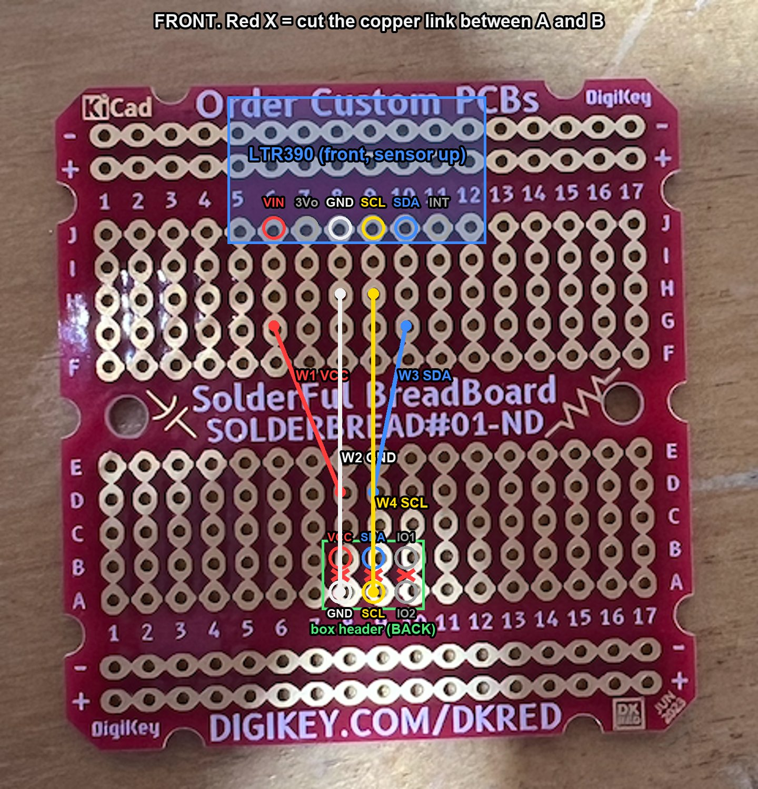
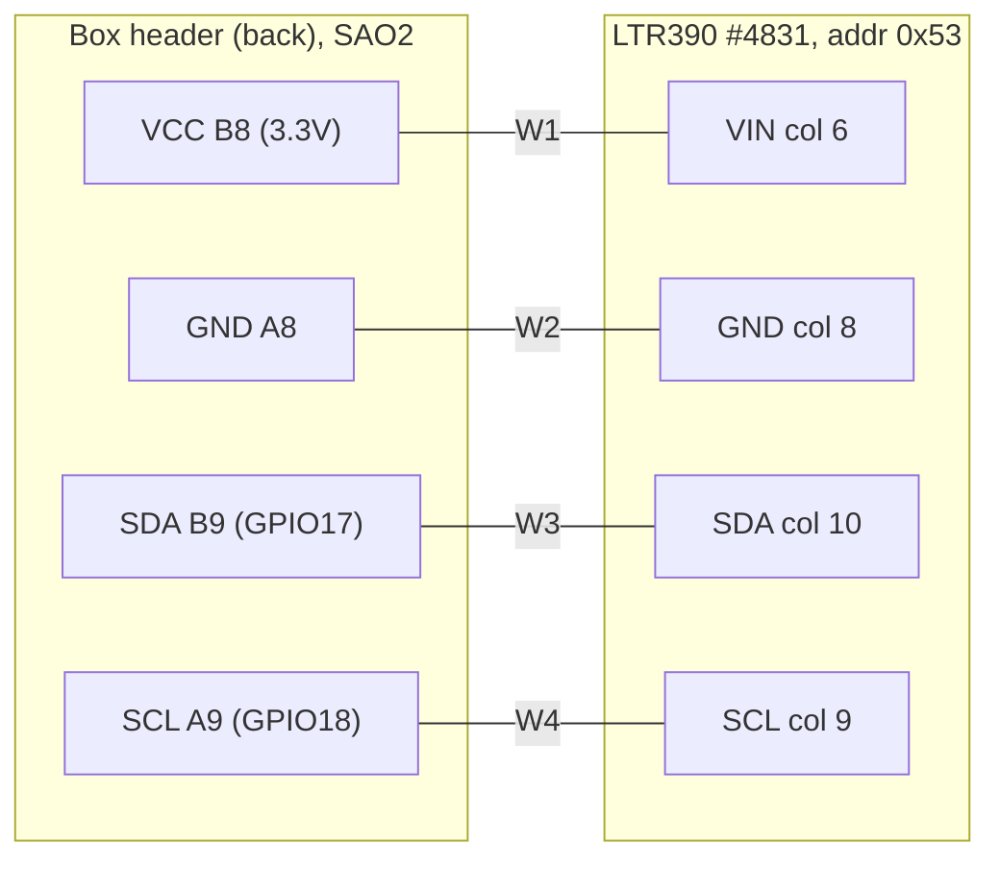

# Sun SAO, UV only (DigiKey SolderFul BreadBoard)

A fresh start with one sensor: the Adafruit LTR390 (#4831) on a DigiKey SolderFul BreadBoard
(SOLDERBREAD#01-ND), with a keyed 2x3 box header on the back. Plugs into SAO2 (middle port). The
earlier three-sensor layouts are in [WIRING.md](WIRING.md) and [option2/](option2/WIRING.md).

## Board layout

Breadboard pattern: 17 columns. In each column, rows F-J are joined and rows A-E are joined. The
`+`/`-` rails along the top and bottom are joined across, and top and bottom rails are separate.
This layout uses no rails.

## Header pinout (seen from the front of the SAO)

Standard SAO pinout, with VCC top left as checked on the badge. **GND is directly below VCC.**

| | col 8 | col 9 | col 10 |
|---|---|---|---|
| row B (top) | VCC | SDA | GPIO1 |
| row A (bottom) | GND | SCL | GPIO2 |

The header goes on the **back**, centered on the board (columns 8-10, under the middle of the
LTR390), with its pins in B8-B10 and A8-A10, soldered on the front. That centers the add-on on the
badge connector.

## Build

1. **Cut 3 links** on the front, between rows A and B in columns 8, 9 and 10 (red X in the photo).
   Without the cuts, VCC/GND, SDA/SCL and GPIO1/GPIO2 would be shorted in pairs.
   Check: B8-A8, B9-A9 and B10-A10 must **not** beep.
2. **Box header** on the back: VCC pin in **B8**, GND in **A8**, key facing the same way as on the
   badge. Solder on the front.
3. **LTR390** on the front, sensor side up, pins in row **J**: VIN 6, 3Vo 7, GND 8, SCL 9, SDA 10,
   INT 11. Its board overhangs the top edge.
4. **4 wires** on the front:

| Wire | From | To | Net |
|---|---|---|---|
| W1 | D8 (column 8 strip, header VCC) | G6 (LTR VIN) | 3.3 V |
| W2 | A8 (header GND pin) | H8 (LTR GND) | GND |
| W3 | D9 (column 9 strip, header SDA) | G10 (LTR SDA) | SDA |
| W4 | A9 (header SCL pin) | H9 (LTR SCL) | SCL |

## Checks before plugging in (continuity, nothing powered)

1. A8 to B8, A9 to B9, A10 to B10: **no** beep (cuts done).
2. VCC (B8) to GND (A8): **no** beep.
3. SDA (B9) to SCL (A9): **no** beep.
4. B8 to the LTR's VIN pin, A8 to its GND pin, B9 to its SDA pin, A9 to its SCL pin: beep.
   W2 runs up column 8 over the VCC strip: use insulated wire and check B8 to A8 again after it is in.

## After plugging in

The LTR390's power LED (if fitted) lights. `uv run mpremote run scripts/sun_probe.py` shows `0x53` in
the I2C scan and `CHECK PASS UV sensor started`. Set the smoke sensor to
`"sensor_included": false` in `/data/sun_sao.json`, since it isn't on this board.
