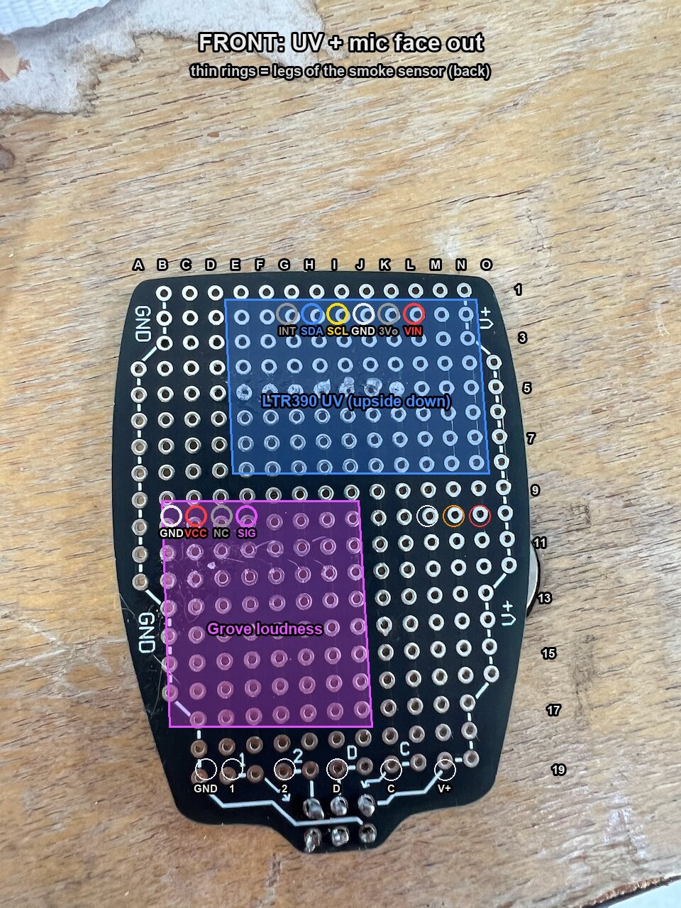
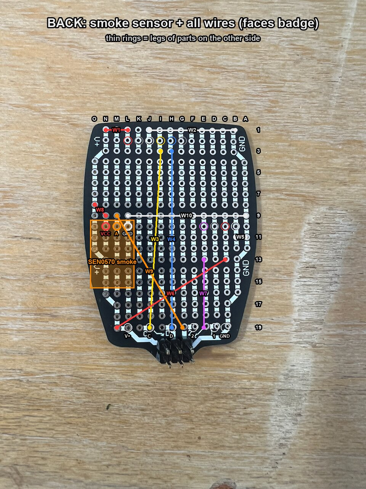

# Sun SAO wiring guide

UV dose meter, smoke alarm and loudness meter on one SAO protoboard. Plugs into **SAO2 or SAO3**
(both GPIO pins are ADC1 there; SAO1's GPIO2 is GPIO42, which has no ADC).

| Front (UV + mic face out) | Back (smoke sensor + all wires, faces the badge) |
|---|---|
|  |  |

Hole names are **column letter + row number as seen from the FRONT**: columns A-O left to right,
rows 1-19 top to bottom. On the back photo the letters run O-A because the board is flipped.

## How this protoboard is connected

Measured from the photos; beep it with a meter before soldering (step 1 below).

- **V+ rail**: right edge on the front (column O rows 4-13, N rows 1-3), runs to the V+ pad.
- **GND rail**: left edge on the front (column A rows 4-12, B rows 1-3), runs to the GND pad.
- **Strips**: each column between the rails is a vertical strip, cut into blocks: rows 1-3, 4-8,
  9-13, 14-18.
  A leg and a wire in the same column and the same block are connected.
- **Pads** (row 19, two holes each): GND C19, `1` D19/E19, `2` F19/G19, `D` (SDA) H19/I19,
  `C` (SCL) J19/K19, V+ L19/M19.

| Pad | SAO pin | On SAO2 | On SAO3 | Used for |
|---|---|---|---|---|
| V+ | 1 VCC | 3.3 V | 3.3 V | all sensors |
| GND | 2 GND | GND | GND | all sensors |
| D | 3 SDA | GPIO17 | GPIO17 | LTR390 SDA |
| C | 4 SCL | GPIO18 | GPIO18 | LTR390 SCL |
| 1 | 5 GPIO1 | GPIO4 | GPIO7 | loudness SIG (analog) |
| 2 | 6 GPIO2 | GPIO5 | GPIO6 | smoke A (analog) |

## Parts and placement

| Part | Side | Legs (hole) | Notes |
|---|---|---|---|
| Adafruit LTR390 UV (#4831) | front, upside down (header at the top edge) | INT G2, SDA H2, SCL I2, GND J2, 3Vo K2, VIN L2 | Sensor window faces out. 3Vo and INT unused. |
| Seeed Grove Loudness v0.9b | front, below the UV board | GND B10, VCC C10, NC D10, SIG E10 | Solder a 4-pin header into its SIG/NC/VCC/GND holes. NC unused. |
| DFRobot SEN0570 smoke | back, lower right | GND L10, A M10, VCC N10 | Faces the badge. Legs poke through to the front in an empty area. |

The pin order on the LTR390 (VIN, 3Vo, GND, SCL, SDA, INT) is assumed; wire by the names printed on
your board, not by position. Body outlines in the photos are approximate: dry-fit all three before
soldering.

## Jumper wires (all on the back)

Use insulated wire (30 AWG wire-wrap is ideal). Wires may cross each other.

| Wire | From | To | Net |
|---|---|---|---|
| W1 | L1 (LTR VIN strip) | N1 (V+ rail) | V+ |
| W2 | J1 (LTR GND strip) | B1 (GND rail) | GND |
| W3 | I3 (LTR SCL strip) | J19 (pad C) | SCL |
| W4 | H3 (LTR SDA strip) | H19 (pad D) | SDA |
| W5 | B11 (Grove GND strip) | A11 (GND rail) | GND |
| W6 | C13 (Grove VCC strip) | M19 (V+ pad) | V+ |
| W7 | E13 (Grove SIG strip) | E19 (pad 1) | loudness |
| W8 | N9 (smoke VCC strip) | O8 (V+ rail) | V+ |
| W9 | M9 (smoke A strip) | G19 (pad 2) | smoke |
| W10 | L9 (smoke GND strip) | A9 (GND rail) | GND |

## Build order

1. **Beep the board** (meter on continuity, nothing soldered yet):
   - N1 to O8 to L19: beep (V+). B1 to A11 to C19: beep (GND). V+ to GND: **no** beep.
   - Each strip used above (G-L rows 1-3, B-E rows 9-13, L-N rows 9-13): beeps along its block,
     not to its neighbours. If N13 or B13 beeps to a rail, that is fine (same net as the leg).
   - The old solder blobs on the front at row 5 (columns F-K) sit under the UV board: wick them or
     check they don't bridge two strips.
2. **Wires first**: W6 and W8 run near the smoke sensor footprint; solder them before the sensor.
3. **Smoke sensor on the back**, then the **Grove** and **LTR390** on the front.
4. **Before plugging in**: V+ to GND must not beep. Each pad (1, 2, D, C) must not beep to V+ or GND.
5. **Clearance**: dry-fit the SAO on the badge. The smoke sensor on the back must not touch the
   badge; if it does, move it to the front at the same holes (front columns J-O, rows 9-18 are free).

## Electrical notes

- Supply is the badge's 3.3 V. LTR390 and SEN0570 are rated 3.3-5 V. The Grove loudness sensor is
  rated 3.5-10 V; it is expected (not yet measured) to work at 3.3 V with its output capped near 1.8 V.
- All analog outputs stay below 3.3 V, so no divider is needed.
- I2C: the LTR390 board has 10k pull-ups, in parallel with the badge's R1/R3. Address `0x53`.
- The smoke sensor needs at least 300 s of warm-up after power-on before readings mean anything.
- Total draw is under 30 mA.
